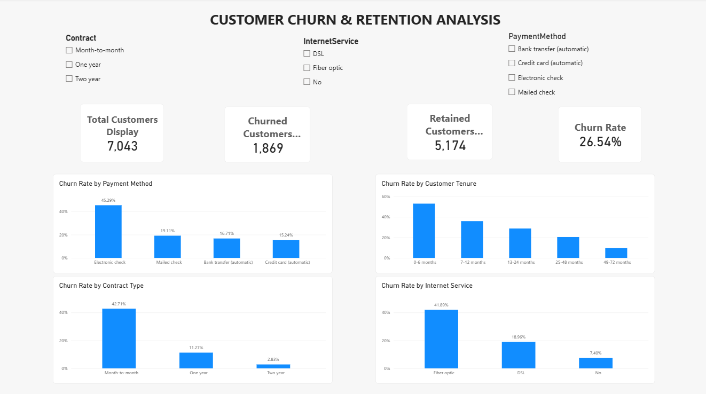

# Customer Churn & Retention Analysis

## Project Overview
This project analyzes customer churn to identify customer segments with high churn rates and uncover opportunities to improve customer retention. It uses Excel, MySQL, Python, and Power BI to transform customer data into actionable business insights.

## Tools & Technologies
- **Excel:** Data exploration, summary analysis, and visualizations
- **MySQL:** SQL queries, aggregations, and customer segmentation
- **Python:** Data cleaning, exploratory data analysis, and visualizations
- **Power BI:** Interactive dashboard and KPI reporting

## Business Objectives
- Measure overall customer churn and retention.
- Compare churn across contract types.
- Identify tenure groups with higher churn rates.
- Analyze churn by payment method and internet service.
- Recommend potential customer retention strategies.

## Key Findings
- **Total customers:** 7,043
- **Churned customers:** 1,869
- **Retained customers:** 5,174
- **Overall churn rate:** 26.54%
- **Retention rate:** 73.46%

Additional analysis indicates that month-to-month customers and customers with shorter tenure have higher churn rates.

## Dashboard

The interactive Power BI dashboard summarizes customer churn and retention patterns.

### Dashboard Features
- Total, churned, and retained customer KPIs
- Overall customer churn rate
- Churn rate by contract type
- Churn rate by customer tenure
- Churn rate by payment method
- Churn rate by internet service
- Interactive slicers for exploring customer segments

## Key Findings

- **Total customers:** 7,043
- **Churned customers:** 1,869
- **Retained customers:** 5,174
- **Overall churn rate:** 26.54%
- **Retention rate:** 73.46%

The analysis indicates that month-to-month customers and customers with shorter tenure have higher churn rates. These patterns suggest opportunities to investigate onboarding, customer engagement, and retention offers.

## Business Recommendations

1. Investigate the reasons for higher churn among month-to-month customers.
2. Improve onboarding and customer engagement during the early months.
3. Investigate churn patterns across payment methods and internet services.
4. Test targeted retention strategies and measure their impact.

*These findings describe observed patterns; further investigation is needed to establish the causes of churn.*

## Recommendations
1. Investigate why month-to-month customers are more likely to leave.
2. Improve onboarding and engagement during the first months of service.
3. Evaluate payment-method-related churn patterns.
4. Test targeted retention offers and measure their effectiveness.

## Project Structure
- `Data/` — Source and related data files
- `Excel/` — Excel analysis and dashboard
- `Notebooks/` — Python analysis notebooks
- `outputs/` — Exported analysis results
- `PowerBI/` — Power BI dashboard
- `Sql/` — SQL scripts and queries

## Conclusion
This project demonstrates an end-to-end customer analytics workflow, from data preparation and SQL analysis to Python exploration and interactive Power BI reporting. It highlights how data analysis can support customer retention decisions.

*Note: Recommendations are hypotheses to test; this analysis identifies associations and does not establish the causes of churn.*
